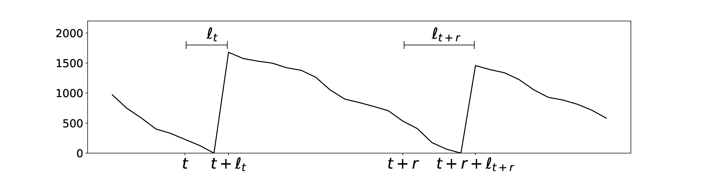
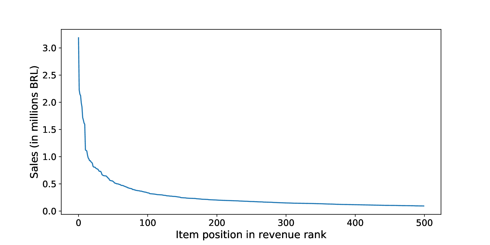
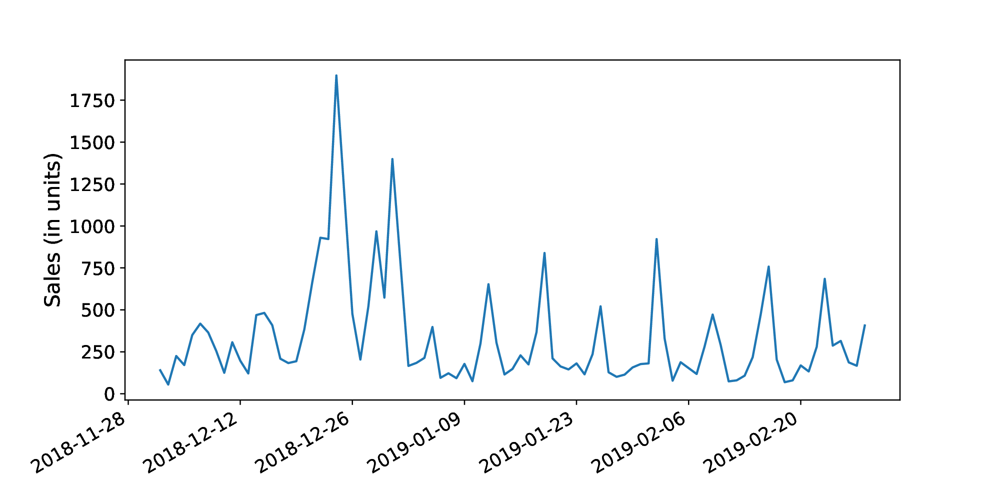
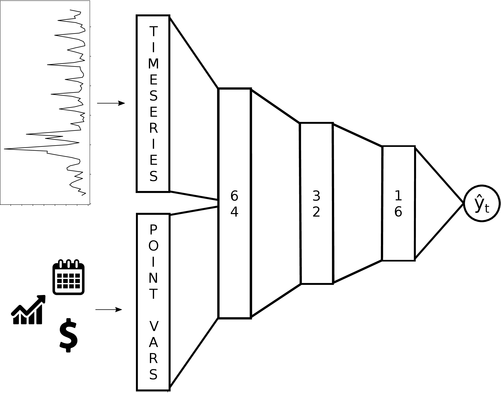
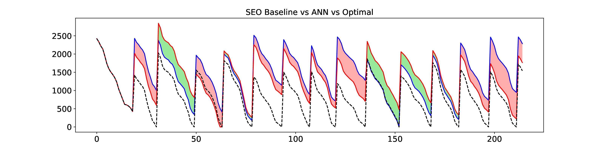

# Quantile Forecasts Using Neural Networks for Retail Inventory Management with Fixed-Time Replenishment Intervals

**📖 [Read the thesis online](thesis.md)**, or use the PDFs below.

Master's thesis in Informatics, Graduate Program in Informatics (PPGI), Federal University of Amazonas (UFAM), Manaus, Brazil. This repository holds the text and slides of the **preliminary defense** (qualifying exam), August 2019.

- **Author:** Willians Cassiano de Freitas Abreu
- **Advisor:** Prof. Marco Antônio Pinheiro de Cristo
- **Co-advisor:** Prof. Juan Gabriel Colonna

## Files

| File | Description |
|---|---|
| [Master's Thesis Text Preliminary Defense.pdf](Master's%20Thesis%20Text%20Preliminary%20Defense.pdf) | Thesis text (English, 58 pages) |
| [Master's Thesis Preliminary Defense.pdf](Master's%20Thesis%20Preliminary%20Defense.pdf) | Defense slides (English, 27 slides) |

## Summary

A retailer has to keep enough stock to meet customer demand while suppliers take time to deliver (the lead time). Because sales are uncertain, retailers keep safety stock, which creates overstocking costs: holding costs, opportunity costs, and losses from damaged, expired and stolen items. Keeping too little stock causes stock-outs, which can cost even more than overstocking depending on the product segment.

The work addresses both problems together. It builds a mathematical model of the financial loss from stock-outs and overstocking in a setting where **demand and lead times are stochastic and replenishment happens at fixed intervals**. It then trains neural networks to minimize that loss directly, instead of forecasting demand and deriving an order quantity from the forecast.

*The optimal inventory series of one item. An order placed at decision point $`t`$ arrives after the lead time $`\ell_t`$, and the next one, placed at $`t + r`$, arrives after $`\ell_{t+r}`$. The order at $`t`$ has to cover demand until that second arrival, so both stochastic lead times enter the purchase decision.*

Main ideas:

- **Service levels as quantile forecasts.** The target service level of an item maps to a quantile of the demand distribution over the lead time. The models are trained with the **pinball (quantile) loss**.
- **Optimizing the business cost directly.** The thesis proposes an objective function for gradient descent that encodes the cost of overstocking and stock-outs, so the network learns the order policy itself.
- **Case study on real retail data.** The case study uses daily sales from a Brazilian retailer, focused on the best-selling items (the "A1" segment). For example, the top 500 items account for about half of revenue.
- **A simulator of retailer mechanics.** It replays real demand and lead times to compare the neural network policy against a classical baseline and against the optimal inventory series.

## Case study and preliminary results

### Data

The case study covers seven stores of a medium-sized Brazilian supermarket chain in four cities, with about R\$ 267m in revenue in 2018. Held inventory takes 3 to 6% of annual revenue (over R\$ 16m at the maximum). About 6 years of daily sales and order records (including delivery dates, and so lead times) are available.

*Items ranked by 2018 revenue. The curve falls off steeply: the top 500 items bring in 51% of revenue (R\$ 139m). These best sellers (the A1 segment) are the focus: there, stock-outs are estimated to cost ten to twenty times more than overstocking.*

*Daily sales of a popular beer brand in Store 1 over about three months around the 2018 holidays. Roughly weekly spikes and a large peak at the end of the year make demand hard to predict with a single stationary distribution.*

### Model

Each training example combines the last 21 days of sales (log-transformed and z-scored) with variables known at the decision point: price and price trends, an upcoming-promotion flag, and one-hot week and month of year. The target is the cumulative demand until the next order arrives, with both lead times sampled from the lead times observed in the Orders history, so no distribution is assumed for demand or lead times.

*The feed-forward network used in the preliminary experiments. Separate input blocks for the lagged time series and the decision-point variables feed dense layers of 64, 32 and 16 units, then a single quantile output $`\hat{y}_t`$ (30% dropout, 100 epochs, trained on data from January 2013 to January 2018). The time-series block is kept separate so it can later be swapped for a temporal model.*

### Preliminary result

*Simulated inventory for the beer item: neural network (blue), SEO baseline that assumes Gaussian stationary demand and lead times (red), and the optimal series (dashed). Red fill marks where the baseline did better, green where the network did.*

In this first test the baseline won on pinball loss, **615.25 vs 863.24**, though the network had **one stock-out day against the baseline's two**. The thesis reads this as comparable performance for a shallow network with no hyperparameter tuning. Next steps are a unitless aggregated pinball loss, temporal architectures (RNNs, LSTMs, GRUs, dilated causal convolutions, stochastic TCNs) and the slower-moving B and C segments.

## Contents

1. **Introduction:** problem definition, research hypothesis and objectives.
2. **Theoretical foundations:** inventory management policies, uncertainty in demand and lead times, service levels and quantile forecasts, the pinball loss, optimizing the cost directly with neural networks, and related work.
3. **Neural networks for quantile forecasts:** the case study dataset, preprocessing, and the network architecture and training.
4. **Simulator, model evaluation and preliminary results.**
5. **Open problems and next steps:** aggregated pinball loss, temporal connectionist models, extending to the B and C segments, and the schedule.

**Keywords:** inventory management, deep learning, quantile forecasting.
